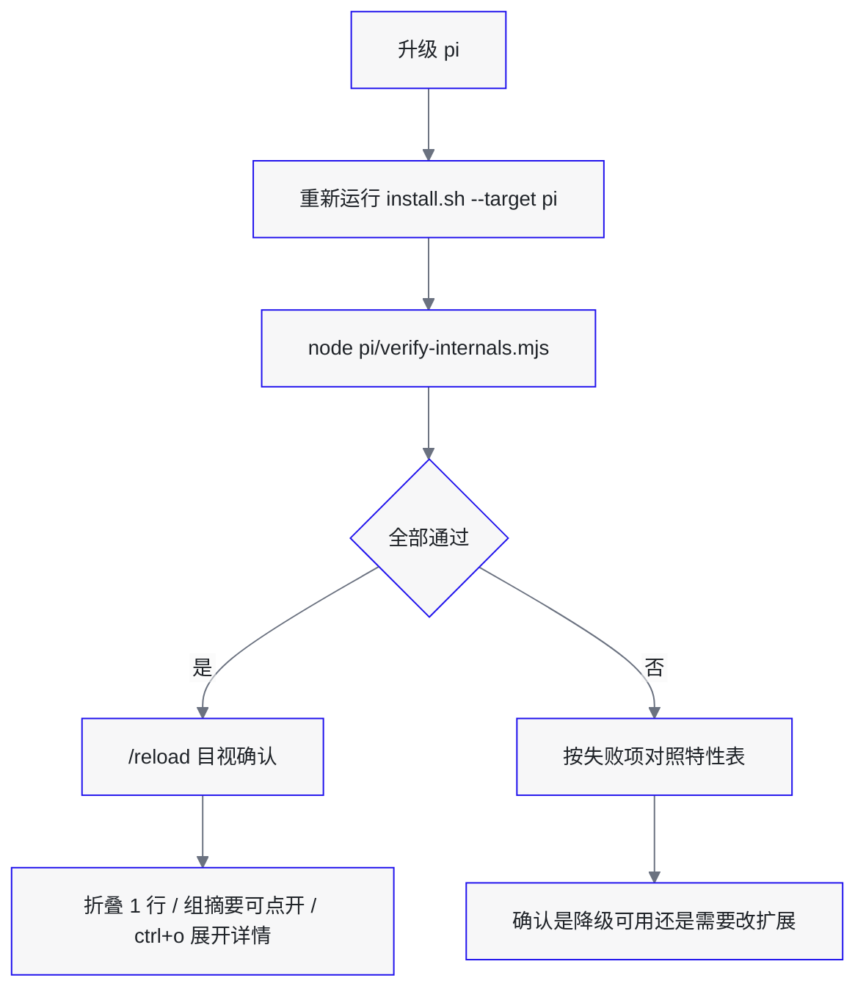

# Pi 专有配置

本目录只服务 Pi，仓库持有真实文件，`~/.pi/agent/` 下只放软链接。安装与链接规则由根目录的 `install.sh` 负责，结构说明见 [../README.md](../README.md)。

## 目录内容

| 路径 | 作用 |
| --- | --- |
| `APPEND_SYSTEM.md` | 追加到 pi 系统提示末尾，补充过程播报、子 agent 委派等行为约束 |
| `extensions/tool-preview-lines.ts` | 接管工具调用渲染：折叠成一行，连续调用合并为可展开的折叠组；`/tool-lines` 的 off 子命令可在运行时改回原生渲染 |
| `extensions/skill-shortcuts.ts` | `/skill:name` 在消息任意位置展开，并提供补全 |
| `extensions/exit-alias.ts` | 把 `/exit` 注册为 `/quit` 的别名 |
| `verify-internals.mjs` | 校验扩展依赖的 pi 内部特性是否仍然成立 |

## 内部特性依赖

`tool-preview-lines.ts` 为了实现紧凑显示，用到了几处没有写进扩展 API 文档的细节。它们不是承诺稳定的接口，升级 pi 后需要重新确认。

当前记录基于 pi 1.4.0。

| 特性 | 用途 | 1.4.0 下的现状 | 失效后的表现 |
| --- | --- | --- | --- |
| `ToolExecutionComponent` 从包根导出 | patch 的入口 | 与 `ToolRenderers`、`renderDiff` 等同级导出 | patch 安装失败，退回带上下留白的卡片 |
| 扩展与宿主共享同一份包实例 | 让 patch 作用到真实组件 | loader 以 `moduleCache: false` 加载扩展，但对 ESM 依赖走原生 import，共享模块缓存 | patch 装到另一份原型上，静默无效 |
| 实例字段 `contentBox`、`expanded` | 压低卡片内边距 | 构造与 `setExpanded` 时写入 | 内边距不生效，折叠块仍有上下留白 |
| `contentBox` 是 `Box(1, 1)` | 折叠时把 `paddingY` 设为 0 | 默认外壳用 Box，提供背景和横向内边距 | 折叠块仍占三行 |
| `children[0]` 是 `Spacer(1)` | 独立工具保留空行，组内成员压到 0 | 构造函数里固定添加，支持 `setLines()` | 组内出现空行，或独立工具紧贴上文 |
| `updateDisplay()` 在展开切换时调用 | 同步 `paddingY` 与 Spacer 高度 | `setExpanded` 后调用 | 内边距和块间距不随展开状态变化 |
| 组标题行布局 | 折叠与收起 | 组固定输出「空行 + 标题」两行，成员从第 2 行开始 | 点击区域与渲染行错位 |
| 渲染行数与鼠标坐标同源 | 点击展开 | `handleMouse()` 按 children 的实际高度换算坐标 | 改渲染行却不改布局，点击位置错位，工具无法展开 |
| 默认外壳的 MouseRegion | 点击展开 | 渲染器返回的组件会被 `createResultRegion` 包裹 | 保留默认外壳即保留点击展开，不需要额外 patch 坐标 |
| `Container.prototype.addChild` | 折叠组的分组入口 | pi 把每个工具组件直接 `chatContainer.addChild(...)`；`Container` 来自 pi-tui | 无法分组，工具退回逐个显示 |
| `AssistantMessageComponent` 的类名与 `lastMessage` | 识别只含 toolCall、渲染为空的消息 | 未压缩模块保留类名；`lastMessage.content` 可直接读 | 空的 assistant 组件夹在两轮工具之间，分组被打断 |
| 工具组件的 `isPartial`、`result.isError`、`ui.requestRender` | 组摘要的状态与重绘 | 都是实例字段，`updateResult` 时更新 | 摘要不显示 running/failed，或点击后不重绘 |
| `dispatchMouseEvent` 调用 `handleMouse` | 组内成员点击转发 | `Container.handleMouse` 按 child 渲染高度分发 | 组展开后点击定位错位 |
| 工具组件的 `setExpanded()` | 组内成员整卡片可点 | 只改内部状态，需自行 `ui.requestRender()` | 点击卡片空白行无响应 |
| `TuiMouseEvent.type` 包含 `move`/`wheel` | 点击与 hover 区分 | 鼠标移动也会分发到 `handleMouse` | 切换逻辑漏判类型时 hover 就会改状态 |
| 全局主题 `Symbol.for("@earendil-works/pi-coding-agent:theme")` | 组摘要行着色 | `initTheme` 后挂在 `globalThis` 上，用于跨模块加载器共享 | 摘要退化为无色文本 |
| renderer context 的 `state`、`isPartial`、`durationMs`、`invalidate` | 折叠摘要、耗时显示、延迟重绘 | 每次渲染传入，`state` 跨渲染保留 | 摘要和耗时失效，或重绘不触发 |
| `Text` 组件补齐整宽 | 说明为何展开内容不用内置 `Text` | 即使没有背景色也会把每行补到终端宽度 | 不影响正确性，仅行尾空格问题 |
| 辅助函数导出 | 复用内置渲染能力 | `renderDiff`、`highlightCode`、`getLanguageFromPath`、`formatSize`、`DEFAULT_MAX_BYTES`、`keyHint` | 扩展加载即报错 |
| `@earendil-works/pi-tui` 导出 | 自绘单行与多行组件 | `Container`、`visibleWidth`、`wrapTextWithAnsi`、`stripTerminalSequences` | 扩展加载即报错 |

## 升级 pi 后验证



命令：

```bash
cd /你的路径/agent-config
bash install.sh --target pi
node pi/verify-internals.mjs
```

`verify-internals.mjs` 自动完成这些检查：

- 读出版本，确认 pi 包可以定位。
- 检查扩展依赖的导出是否还在。
- 用与 pi 相同的 loader 配置加载扩展，确认注册成功、六个工具都使用默认卡片外壳。
- 确认扩展拿到的 `ToolExecutionComponent` 就是宿主使用的那一个，且 patch 已写入原型。
- 确认折叠工具把块前 Spacer 压到 0、`paddingY` 压到 0，展开时二者都恢复；布局对包括 `read` 在内的所有工具生效。
- 用真实 `ToolExecutionComponent` 渲染一次折叠卡片，确认只有 1 行，且第一行的点击能触发展开。
- 确认连续工具会合并成折叠组、单个工具也建组、插入文本后另开一组。
- 确认只含 toolCall 的 assistant 组件不会断开组，含文本的仍断开，内容为空的不会被误删。
- 确认组前保留一行空行，点击标题行能展开、再点能收起，组摘要能反映 running 与 failed。
- 确认展开态仍显示耗时，且工具结束后计时器被清理。
- 确认工具参数与路径里的控制字符会被清除（终端转义注入防护）。
- 确认折叠时调用行 1 行、结果区 0 行，摘要经过一次延迟重绘后出现。
- 确认 `Text` 仍然补齐整宽；如果哪天不再补齐，`PlainText` 可以考虑去掉。
- 确认补丁所有权记在全局登记表里，两个原型上装的都是本扩展的包装函数。
- 确认 `/tool-lines off` 能把两个原型还原、渲染器让位给原生实现，且登记表清空。
- 确认 `/tool-lines on` 能把补丁和渲染器都装回来，`/tool-lines status` 报告开关与归属。
- 确认重新加载模块后 `original` 仍是原生方法，调用链不随 `/reload` 次数变长。
- 确认别的扩展接管原型方法后，关闭只放弃所有权，不把对方的补丁写回自己的 `original`。

脚本默认从 `npm root -g` 和 `which pi` 推断包位置，也可以显式指定：

```bash
node pi/verify-internals.mjs ~/.nvm/versions/node/v24.22.1/lib/node_modules/@earendil-works/pi-coding-agent
PI_PACKAGE_DIR=/path/to/pi-coding-agent node pi/verify-internals.mjs
```

退出码为 0 表示全部通过，1 表示有失败项。

## 改动这些文件时注意

`verify-internals.mjs` 的断言直接对应上表。新增依赖内部结构的实现时，同步补一条检查，避免升级后只能靠肉眼发现。

`installCompactRows()` 和 `installToolGroups()`（各自配一个 `uninstall*`）是仅有的两处改写 pi 运行时对象的地方，其余逻辑都走公开扩展 API。修改时要保留三层保护：安装过程的 `try/catch`、分组 patch 限定成员类型，以及所有权登记表（`PATCH_TABLE_KEY`）——它替代了早期写在原型上的布尔幂等标记。

登记表挂在 `globalThis` 上而非模块作用域，因为 `/reload` 换掉的只是模块实例。每个条目同时存 `wrapper` 和 `original`：`wrapper` 用来判断原型上的方法是否还归本扩展，`original` 用来还原。两条不变量不要拆开看：

- 安装时若发现上一个实例的 `wrapper` 还挂在原型上，先剥回它的 `original` 再重新包装，否则每 reload 一次调用链就多一层。
- 卸载时只有原型上仍是自己的 `wrapper` 才写回 `original`。别的扩展在之后包了一层时，链上留着我们的包装函数无副作用，但把它覆盖成我们的 `original` 会直接抹掉对方。

`setEnabled()` 是唯一同时操作两个补丁和计时器的地方，`/tool-lines off` 就是调它。扩展加载时也调 `setEnabled(enabled)`：配置里写明关掉后，`/reload` 前那个实例残留的包装函数会一并卸掉。关闭后已渲染的旧组件保持现状（折叠的仍然折叠），只有后续工具调用回到原生渲染；`/reload` 会按配置重新决定要不要装回来。

分组是替换 `chatContainer.children` 的结构：每个工具组件都会变成 `ToolGroup`（单个工具也一样，保证折叠外观一致），中间插入任何普通组件都会断开。新增依赖这一结构的逻辑前，先确认它不需要直接看到单个工具组件。

`ToolGroup` 固定输出两行头部（第 0 行空行、第 1 行标题），成员从第 2 行开始。点击第 0、1 行切换折叠，其余行按成员高度偏移转发。改变这个行布局时，必须同步 `handleMouse` 的偏移量。

分组前会清掉末尾「只含 toolCall」的 assistant 组件，否则 pi 每轮先加入的消息容器会把连续工具拆开。只清理 `content` 非空且没有 text/thinking 的组件；`content` 为空说明消息刚流式开始，必须保留。

折叠组的展开状态存在 `ToolGroup` 实例上，`/compact`、切换分支或重启会话重建 transcript 后会回到默认折叠；当前不做持久化。

减高度只能改布局，不能在渲染结果里删行。块前空行由 `children[0]` 的 `Spacer` 产生，用 `setLines(0)` 把它压掉；`Box` 的内边距用 `paddingY` 调和。曾经试过在 `render()` 里删掉首行、配合 `renderShell: "self"` 减内边距，结果 `handleMouse()` 仍按旧布局换算坐标，第一行的点击被吞掉，表现为工具无法展开。渲染行数与点击坐标必须从同一个布局来。
